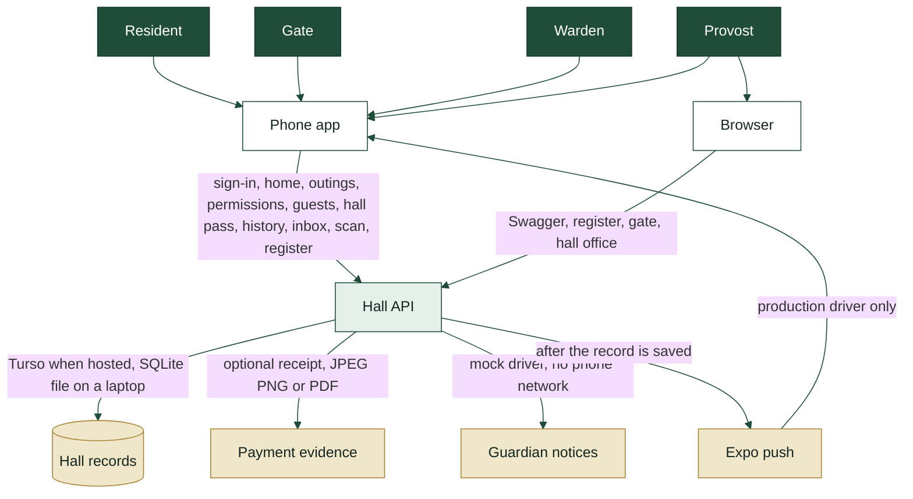
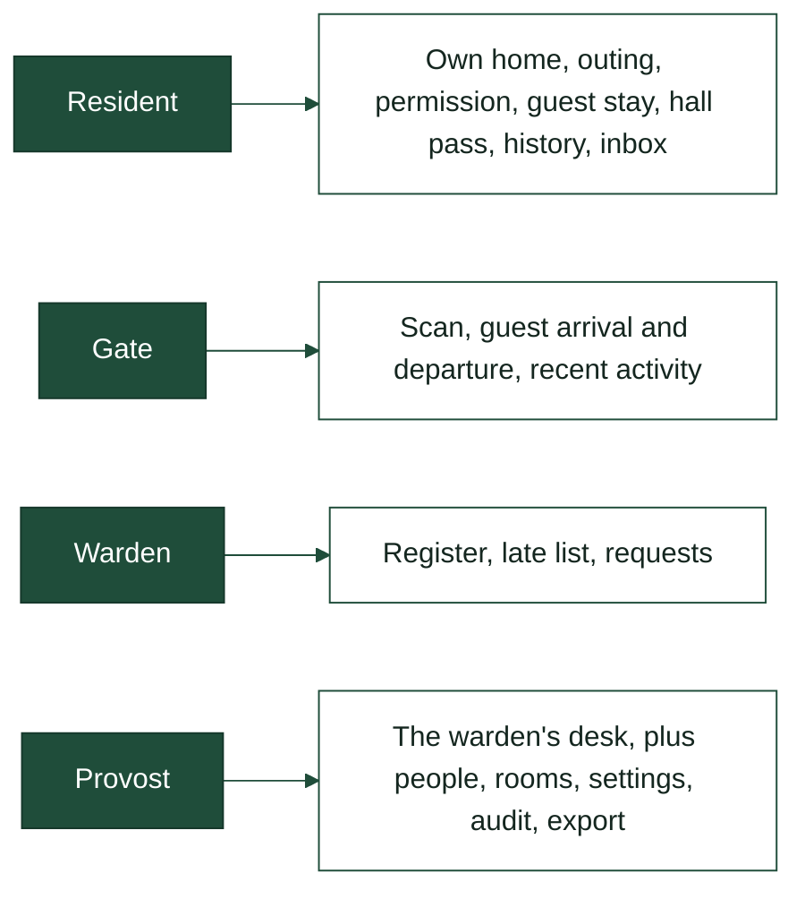
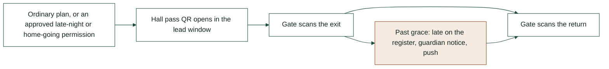
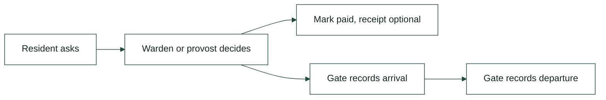

# Begum Sultan Jahan Hall

Movement for one hall: who is inside, who is out, who is late, and who is still waiting on a decision.

Residents, gate staff, wardens, and the provost use the Expo app in `mobile/`. The hall API is FastAPI in `backend/`, under `/api/v1`. A laptop serves it at `http://localhost:8000`. Release phone builds call `https://bsj-hostel-api.onrender.com`.

Work lands on `dev`. `main` is production and accepts pull requests only.

## How it fits together



The same data model is applied at startup. Hosted hall records live in Turso. A laptop and the checks use `backend/data/hostel.db`. The arrow-by-arrow account is [`docs/architecture/system-architecture.md`](docs/architecture/system-architecture.md).

## Who opens what



| | Resident | Gate | Warden | Provost |
|---|---|---|---|---|
| Own outing, permission, guest stay, hall pass | Yes | | | |
| Scan a hall pass, record a guest in or out | | Yes | Yes | Yes |
| Register, late list, decide requests, mark a guest paid | | | Yes | Yes |
| People, rooms, settings, audit, SMS log, register export | | | | Yes |

A resident can delete her own account. Parents have no login. Guests have no pass of their own.

## One outing



The hall pass and the gate use one rule for which outing she can use now. An ordinary exit is refused until 30 minutes before it starts. A permission uses its own lead. An approved permission that overlaps another is refused. Back-to-back is allowed.

## A guest stay



Payment is a mark on the stay, not a card charge. Evidence is a file the hall stores. The client never sees the file path.

## Run it

From `backend/`, with Python 3.11 or newer:

```bash
python3 -m venv .venv
source .venv/bin/activate
pip install -r requirements.txt
cp .env.example .env
uvicorn app.main:app --reload
```

Set `APP_SECRET_KEY` to at least 32 bytes. Keep `SMS_DRIVER=mock` unless `ENVIRONMENT` is `production`.

| | |
|---|---|
| Swagger | http://localhost:8000/docs |
| Health | http://localhost:8000/health |
| Ready | http://localhost:8000/ready |

Seed local accounts from `backend/` with `.venv/bin/python -m app.dev_seed`. It runs only in development and refuses Render. Passwords come from `BSJ_SEED_PASSWORD` or a per-role `BSJ_SEED_PASSWORD_*` value, in the shell or in `backend/.env`. A missing one is generated and printed once. A password from settings is not printed. An account that already exists is left as it is. `--reset-passwords` sets the seed accounts again. Room B-204 is created for the sample resident. Passwords that once appeared in this repository are burned. Do not reuse them.

Checks and lint, from `backend/`: `.venv/bin/pytest` and `.venv/bin/ruff check .`. A push to `dev`, and a pull request, runs both on GitHub, plus the phone typecheck and tests.

Phone, from `mobile/`: `npx expo start`. Set `EXPO_PUBLIC_API_URL` when the phone should not use the default host.

## Read next

| Document | What it is |
|---|---|
| [`docs/architecture/system-architecture.md`](docs/architecture/system-architecture.md) | The system as it stands |
| [`docs/database/database.md`](docs/database/database.md) | What the hall keeps, and the rules |
| [`docs/api/api.md`](docs/api/api.md) | Every endpoint, for reading |
| [`docs/design/workflows.md`](docs/design/workflows.md) | Screens and steps |
| [`docs/design/design-system.md`](docs/design/design-system.md) | Forest, paper, gold, and type |
| [`docs/tests/tests.md`](docs/tests/tests.md) | Every recorded test |
| [`docs/security/pre-ship-checklist.md`](docs/security/pre-ship-checklist.md) | Before production |
| [`mobile/AGENTS.md`](mobile/AGENTS.md) | Phone commands |
| [`AGENTS.md`](AGENTS.md) | How a change is made |

Swagger serves `backend/openapi.yaml`. A route must be in that file before it is registered.

## Left out of this version

Emergency alerts. A live SMS provider. A payment gateway. Parent accounts. Docker.
