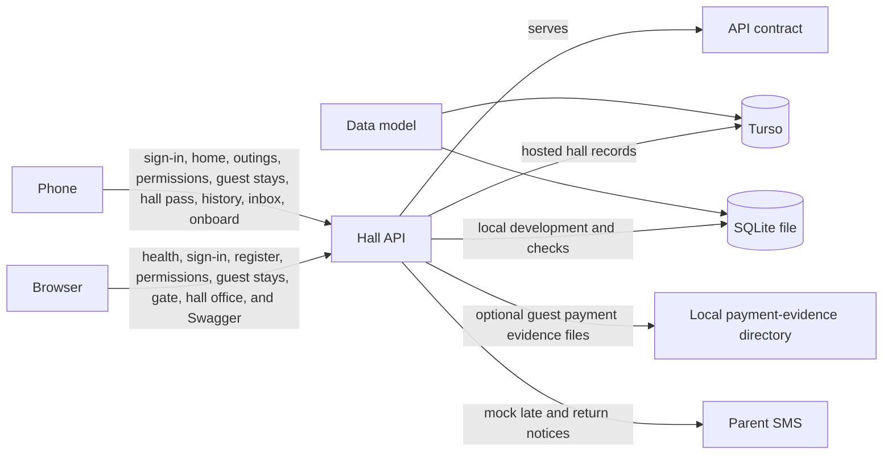

# System architecture

Picture date: **2026-10-11**

This is the system that exists in the repository today. A solid arrow is in use. A dashed arrow is written down and is not on the running path. When a part is added, removed, or connected, this picture is updated in the same change.

| Arrow | Meaning |
|---|---|
| Phone → Hall API | In use. The Expo app in `mobile/` signs in, self-onboards, and serves the resident shell: home (including unread permission decisions), ordinary outings, late-night and home-going permissions, guest stays (edit only while pending and before arrival), hall pass, history, destinations, and the permission-decision inbox. Sign-out clears the session on the phone and revokes the refresh token. She can delete her account from Settings. |
| Browser → Hall API | In use. The process is FastAPI: `http://localhost:8000` in local development, and `https://bsj-hostel-api.onrender.com` for release phone builds (`mobile/eas.json`). Render runs that process only. `GET /health` answers. `GET /ready` opens the hall database and reports `user_version`. On Render that open is Turso, and a failure answers 503 without creating a database file. In local development a missing or unreadable file answers 503 and is not created. Sign-in answers. A warden or the provost can read the register presence board, the permission queue, and guest stays, and can decide pending permissions and guest stays, mark payment, and upload optional payment evidence. Gate staff can scan a hall pass, list recent gate activity, read guest dining occupancy, and record guest arrival and departure. The provost can manage settings, blocks, rooms, destinations, residents, staff, password reset, the audit log, the SMS log, and register CSV export. Swagger is at `/docs`. |
| Hall API → API contract | In use. `/docs` reads `backend/openapi.yaml`. [`api.md`](../api/api.md) is the same contract for reading. The Auth (including resident self-onboard), Resident, Register, Permissions, Guest Stays, Gate, and Hall office paths in that file are implemented and registered. `GET /api/v1/auth/onboard/options` is served for the onboard room picker: active blocks and active rooms with no resident assigned. |
| Data model → Turso | In use on the hosted API. [`database.md`](../database/database.md) is applied to the Turso database `bsj-hall` when the Render process starts. Render does not keep a SQLite file. Turso keeps the schema version in `hall_schema` because it refuses a write to `PRAGMA user_version`. After startup the hall records exist on Turso. |
| Data model → SQLite file | In use for local development and the automated checks. The same document is applied to `DATABASE_PATH` (default `backend/data/hostel.db`). |
| Hall API → Turso | In use when `ENVIRONMENT` is `production`. The process opens `TURSO_DATABASE_URL` with `TURSO_AUTH_TOKEN` and creates the hall when that database is new. It refuses to start while `DATABASE_PATH` is set, and it refuses a file URL. Sign-in reads and writes people, sessions, and the audit log. Resident home, history, hall pass, destinations, ordinary outings, permissions, permission-decision inbox rows, and guest stays (apply, edit, cancel, staff decide/payment) read and write their tables. The register presence board reads active residents by block, open outings for lateness, waiting permissions, and guest stays for the dining and should-have-left counts. Gate scans and gate guest routes read dining occupancy and write outings and guest stays. The hall office reads and writes settings, places, accounts, and audit entries, and reads guardian message rows for the SMS log. The process refuses to start when the signing key is missing or shorter than 32 bytes. |
| Hall API → SQLite file | In use when `ENVIRONMENT` is not `production`. The process opens `DATABASE_PATH` and creates the hall when that file is new. The reads and writes are the same ones listed for Turso. |
| Hall API → Parent SMS | In use with the mock driver. Outside production the process stops unless the SMS driver is mock. Reading the register (and a return scan) records late notices for outside outings past grace; a return scan records the return notice when a late notice was sent. No phone network is contacted. |
| Hall API → Local payment-evidence directory | In use. Optional guest-stay payment evidence (JPEG, PNG, or PDF, at most 5 MiB) is stored under `PAYMENT_EVIDENCE_DIR` (default under the backend data directory). Paths are hall-controlled; clients never receive absolute filesystem paths. Uploading evidence is never required to mark a stay paid. |
