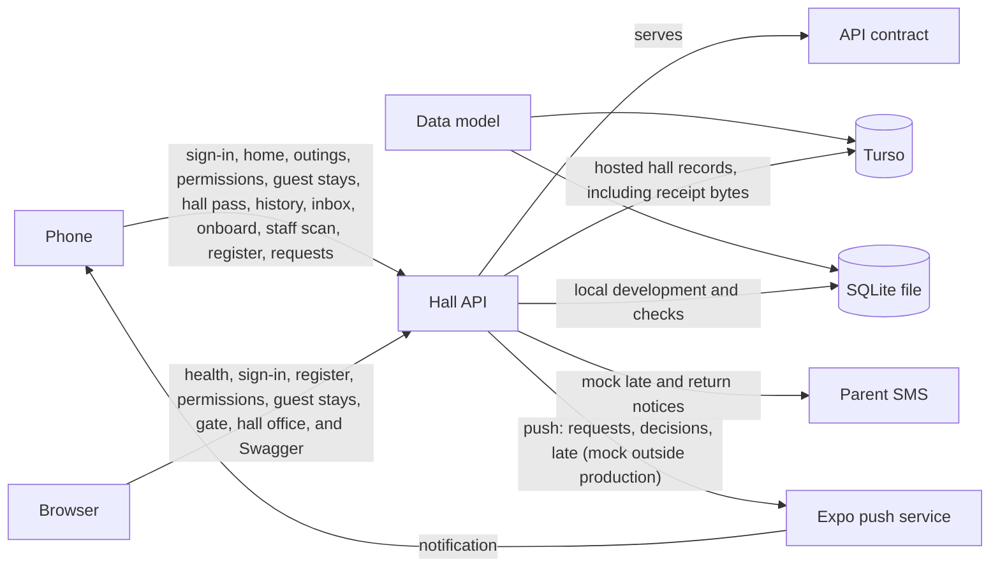

# System architecture

Picture date: **2026-10-13**

This is the system that exists in the repository today. A solid arrow is in use. A dashed arrow is written down and is not on the running path. When a part is added, removed, or connected, this picture is updated in the same change.

| Arrow | Meaning |
|---|---|
| Phone → Hall API | In use. The Expo app in `mobile/` signs in, self-onboards, and serves the resident shell: home (including unread permission decisions), ordinary outings, late-night and home-going permissions, guest stays (edit only while pending and before arrival), hall pass, history, destinations, and her inbox for permission decisions, guest-stay decisions, and a late return. The bell shows the unread count. Sign-out clears the session on the phone, deletes that phone's push token, and revokes the refresh token. She can delete her account from Settings. Gate, warden, and provost accounts open the staff shell instead: Home shows recent gate activity, and for a warden or the provost the register summary with Out now and a bell for their inbox. Scan records a leave or return from a hall pass, by camera or typed code. Requests lets a warden or the provost decide pending permissions and guest stays. |
| Browser → Hall API | In use. The process is FastAPI: `http://localhost:8000` in local development, and `https://bsj-hostel-api.onrender.com` for release phone builds (`mobile/eas.json`). Render runs that process only. `GET /health` answers. `GET /ready` opens the hall database and reports `user_version`. A database that cannot be opened, including a timeout, answers 503. In local development a missing or unreadable file is not created. Sign-in answers. A warden or the provost can read the register presence board, the permission queue, and guest stays, and can decide pending permissions and guest stays, mark payment, and upload optional payment evidence. Gate staff can scan a hall pass, list recent gate activity, read guest dining occupancy, and record guest arrival and departure. The provost can manage settings, blocks, rooms, destinations, residents, staff, password reset, the audit log, the SMS log, and register CSV export. Swagger is at `/docs` in development. Production answers 404 for `/docs`, `/redoc`, and `/openapi.json` unless docs are turned on. The process also refuses to start in production when debug is on, CORS allows every origin, the signing key is a known default, or Render is pointed at a file database. |
| Hall API → API contract | In use. `/docs` reads `backend/openapi.yaml`. [`api.md`](../api/api.md) is the same contract for reading. The Auth (including resident self-onboard), Resident, Register, Permissions, Guest Stays, Gate, Devices, and Hall office paths in that file are implemented and registered. `GET /api/v1/auth/onboard/options` is served for the onboard room picker: active blocks and active rooms that still have a free bed. Public signup stays on until `ONBOARD_ENABLED` is turned off for launch. While it is off, signup asks the resident to go to the hall office and does not say whether an account exists. |
| Data model → Turso | In use on the hosted API. [`database.md`](../database/database.md) is applied to the Turso database `bsj-hall` when the Render process starts. |
| Data model → SQLite file | In use for local development and the automated checks. The same document is applied to `DATABASE_PATH` (default `backend/data/hostel.db`). |
| Hall API → SQLite file | In use on a laptop and in the automated checks. The process opens `DATABASE_PATH` and creates the hall when that file is new, including when Turso credentials are present. The reads and writes are the same ones listed for Turso. |
| Hall API → Parent SMS | In use with the mock driver. Outside production the process stops unless the SMS driver is mock. Reading the register (and a return scan) records late notices for outside outings past grace; a return scan records the return notice when a late notice was sent. No phone network is contacted. |
| Hall API → Expo push service | In use with `PUSH_DRIVER=expo` in production only; outside production the process stops unless the driver is mock, which records the message and contacts nothing. After the request commits, the API posts to `https://exp.host/--/api/v2/push/send` with a 5-second timeout, with `EXPO_ACCESS_TOKEN` as a bearer token when set. Wardens and the provost get new permission and guest-stay requests and residents becoming late; a resident gets decisions on her requests and her own late notice. A `DeviceNotRegistered` ticket deletes that token. A failure is logged and never reaches the caller. |
| Expo push service → Phone | In use once the phone registers its token at `POST /api/v1/devices/push-token`. The data is `notification_id`, `kind`, `record_id`, and `resident_id` for the deep link; the badge is the unread count. |
| Hall API → Turso | In use on Render, where `RENDER` is `true`. TestFlight calls that API. The process opens `TURSO_DATABASE_URL` with `TURSO_AUTH_TOKEN` and creates the hall when that database is new. It refuses to start while `DATABASE_PATH` is set, and it refuses a file URL. A laptop ignores Turso settings and opens the SQLite file. Sign-in reads and writes people, sessions, and the audit log. Resident home, history, hall pass, destinations, ordinary outings, permissions, her inbox (permission and guest-stay decisions, and a late return), and guest stays (apply, edit, cancel, staff decide/payment) read and write their tables. Optional payment evidence bytes (JPEG, PNG, or PDF, at most 2 MiB) are stored in `guest_stay_payment_evidence` on that same database. The hall does not keep a receipt file on disk. The register presence board reads active residents by block, open outings for lateness, waiting permissions, and guest stays for the dining and should-have-left counts. Gate scans and gate guest routes read dining occupancy and write outings and guest stays. The hall office reads and writes settings, places, accounts, and audit entries, and reads guardian message rows for the SMS log. The process refuses to start when the signing key is missing or shorter than 32 bytes. |
