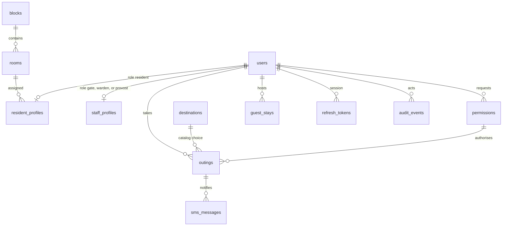

# Begum Sultan Jahan Hall — data model

Schema version: **0.1.0**

Status: contract. These tables are not created yet. The first migration, when the API is implemented, must match this document.

This file owns tables, columns, constraints, stored states, and the rules that decide how a row changes. The same behavior over HTTP is [`api.md`](api.md). The picture of what is running is [`system-architecture.md`](system-architecture.md). Technology choices for later hosting stay in [`architecture.md`](architecture.md).

## Contents

- [Sources](#sources)
- [Confirmed behavior](#confirmed-behavior)
- [Open decisions](#open-decisions)
- [Conventions](#conventions)
- [How the records relate](#how-the-records-relate)
- [Hall settings](#hall-settings)
- [Places](#places)
  - [blocks](#blocks)
  - [rooms](#rooms)
  - [destinations](#destinations)
- [Accounts](#accounts)
  - [users](#users)
  - [resident_profiles](#resident_profiles)
  - [staff_profiles](#staff_profiles)
  - [refresh_tokens](#refresh_tokens)
- [Permissions](#permissions)
  - [Permission lifecycle](#permission-lifecycle)
- [Outings](#outings)
  - [Ordinary outing](#ordinary-outing)
  - [Leaving on a permission](#leaving-on-a-permission)
  - [Return](#return)
  - [Late](#late)
- [Guest stays](#guest-stays)
  - [Guest lifecycle](#guest-lifecycle)
  - [Derived guest buckets](#derived-guest-buckets)
- [SMS](#sms)
- [Audit](#audit)
- [Who can do what](#who-can-do-what)
- [Register counts](#register-counts)
- [SMS and audit are the history](#sms-and-audit-are-the-history)
- [What this version does not store](#what-this-version-does-not-store)
- [DDL](#ddl)
- [Revisions](#revisions)

## Sources

Confirmed behavior comes from the hall proposal and the workflows in `reference/demo/` and `reference/prototype/`. Where those sources do not decide a detail the system still needs, the detail is listed under Open decisions and stored as a hall setting rather than hard-coded.

## Confirmed behavior

- The hall is Begum Sultan Jahan Hall, Aligarh Muslim University. About 400 residents and about 10 staff: residents, wardens, gate staff, and the provost.
- A resident has one permanent hall pass. The QR is not regenerated for each outing. The same code records exit and return.
- An ordinary outing has a destination and an expected return. The resident sets both before leaving. No warden approval. The gate scan records the exit.
- Grace is 30 minutes after the expected return. The demo uses 7:00 PM expected and 7:30 PM grace.
- A parent SMS is sent only when grace ends and the resident is still outside, and only when a parent number is on file. A second SMS is sent when that resident returns. An on-time return sends nothing.
- Late-night permission is for staying in Aligarh after ordinary hours. The warden must approve it before the resident leaves. Fields: destination, reason, outing date, exit time, expected return.
- Home going is leave for home. Fields: home address, reason, departure date and time, return date and time.
- The warden approves or rejects. A rejection does not block an ordinary outing inside ordinary hours.
- Gate staff scan the hall pass. A second immediate scan must not undo the movement. The gate screen for that case says the resident is already outside and should present the same pass on return.
- The warden register shows who is inside, outside, or late, and the pending permissions. Search is by name or room. A resident record shows destination, exit, expected return, grace, actual return, whether the outing is ordinary, and whether the parent SMS was sent.
- The provost sees the whole hall and can export the register.
- A guest stay is applied for by the host resident at least one day before the start date, for at most 7 inclusive days. Friday 18 September through Monday 21 September is 4 days. Payment is marked at the hall office, not collected in the app. Guests have no hall pass. Gate staff record arrival and departure from a list. Guests in hall is a dining count and stays on the count until departure is recorded, including when the end date has passed.
- Emergency alerts are not in this version. The proposal says to skip them if the hall does not want them in the first release. An alert must not approve leave or change outing status if it is added later.
- Parents do not use the app. SMS is the only parent channel.
- Clocks in the product are India time.

## Open decisions

These are stored as settings so the hall can set them without a schema change. Defaults are proposals, not hall rules.

| Setting | Default | Why it is open |
|---|---|---|
| `ordinary_hours_end` | null | The proposal says late-night permission is for time after ordinary hours. It never states the clock time. While this is null, an ordinary outing may be planned at any time within the ordinary-outing bound below, and late-night remains an explicit request. |
| `scan_duplicate_window_seconds` | 45 | The gate demo rejects an immediate second scan. A later scan of a resident who is outside records the return. The window is the gap between those two behaviors. |
| `permission_early_minutes` | 30 | How early a resident may scan out against an approved permission, before its departure time. |
| `ordinary_outing_max_hours` | 18 | How far ahead an ordinary expected return may be. Longer leave is a home-going or late-night permission. |

Sign-in is also unspecified in the proposal. The contract uses hall-issued accounts: a username and a password. A resident's username is their enrolment number. There is no public self-registration and no parent login.

A warden's posting (for example Block B) is a label on the staff profile. The demo register is hall-wide, so a posting does not filter the data that warden can see.

## Conventions

- Primary keys are lowercase UUID strings generated by the application.
- Instants are TEXT in UTC, format `YYYY-MM-DDTHH:MM:SSZ`. The API may accept an offset and must store and return this form. The hall calendar is `Asia/Kolkata`.
- Calendar dates are TEXT `YYYY-MM-DD` in the hall calendar. Guest start and end dates are dates, not instants.
- A time of day setting is TEXT `HH:MM` on a 24-hour clock, hall local.
- Booleans are INTEGER `0` or `1`.
- Enumerations are TEXT with a CHECK constraint.
- Foreign keys are enforced on every connection (`PRAGMA foreign_keys=ON`).
- Write statements use parameters. Identifiers are never interpolated from a request.
- Movements, permissions, guest stays, SMS rows, and audit rows are not deleted. They change status. Rooms, blocks, and destinations are deactivated with `is_active = 0` so history can still name them.
- `updated_at` is set by the application on every update.
- Usernames and enrolment numbers compare case-insensitively and are stored as entered.
- Parent phone numbers are stored in E.164, for example `+919876543210`.
- Password hashes are Argon2id. The plaintext password is never stored and never written to the audit detail.
- The QR payload is `bsj:v1:` followed by `qr_token`. The token is at least 128 bits from a cryptographic random generator. It is not an enrolment number and not a URL.

`resident_profiles.presence` is a copy of the open outing, kept so the register can count inside and outside without a join on every row. It is updated in the same transaction as the outing. Invariants:

- `presence = outside` exactly when that resident has an outing in status `outside`.
- Otherwise `presence = inside`.

## How the records relate



One user has one role. A resident has a resident profile and no staff profile. A staff account has a staff profile and no resident profile.

## Hall settings

One row, `id = 'hall'`.

| Column | Type | Null | Notes |
|---|---|---|---|
| id | TEXT | no | Primary key. Must be `hall`. |
| hall_name | TEXT | no | Begum Sultan Jahan Hall |
| university_name | TEXT | no | Aligarh Muslim University |
| timezone | TEXT | no | `Asia/Kolkata` |
| grace_minutes | INTEGER | no | Default 30. Confirmed by the demo. Applied when an outing is created. Later edits do not rewrite open outings. |
| ordinary_hours_end | TEXT | yes | Local `HH:MM` from 00:00 through 23:59. Null until the hall decides. The SQL check only rejects a malformed string, so the API rejects an hour above 23. |
| ordinary_outing_max_hours | INTEGER | no | Default 18. Open decision. |
| permission_early_minutes | INTEGER | no | Default 30. Open decision. |
| guest_max_inclusive_days | INTEGER | no | Default 7. Confirmed. |
| guest_min_lead_days | INTEGER | no | Default 1. Confirmed. Today cannot be the start date. |
| scan_duplicate_window_seconds | INTEGER | no | Default 45. Open decision. |
| late_sms_template | TEXT | no | Placeholders below. |
| return_sms_template | TEXT | no | Placeholders below. |
| updated_at | TEXT | no | UTC instant. |

Late template, matching the demo:

```text
{resident_name} ({room}) was expected to return by {expected_return_local} and has not yet returned. Please contact the Hall Office if you need to speak to the duty warden.
```

Return template:

```text
{resident_name} ({room}) has returned to {hall_name} at {returned_at_local}. Thank you.
```

Placeholders are replaced in hall local time, 12-hour clock with AM/PM, because that is how the demo messages read. `{room}` is the room label, such as `B-204`.

## Places

### blocks

| Column | Type | Null | Notes |
|---|---|---|---|
| id | TEXT | no | Primary key. |
| code | TEXT | no | Unique. Short code used in room labels, such as `B`. |
| name | TEXT | no | Such as `Block B`. |
| is_active | INTEGER | no | `1` or `0`. |

The demo uses blocks A, B, C, and D. Those are examples. The hall office creates the real blocks. Nothing in the schema limits the hall to four.

### rooms

| Column | Type | Null | Notes |
|---|---|---|---|
| id | TEXT | no | Primary key. |
| block_id | TEXT | no | References `blocks.id`. |
| number | TEXT | no | Such as `204` or `087`. Text so leading zeros survive. |
| label | TEXT | no | Unique. `{code}-{number}`, such as `B-204`. |
| is_active | INTEGER | no | `1` or `0`. |

Unique `(block_id, number)`. A resident points at a room. Changing rooms is an update of `resident_profiles.room_id` plus an audit event. Past outings keep the destination and the resident id; they do not snapshot the room. The register shows the current room.

### destinations

Catalog for the ordinary-outing chips.

| Column | Type | Null | Notes |
|---|---|---|---|
| id | TEXT | no | Primary key. |
| name | TEXT | no | Unique. |
| sort_order | INTEGER | no | Display order. |
| is_other | INTEGER | no | `1` for the single free-text choice. |
| is_active | INTEGER | no | `1` or `0`. |

Initial catalog, taken from the outing screen, inserted by the first migration and editable afterwards:

| sort_order | name | is_other |
|---|---|---|
| 10 | Maulana Azad Library | 0 |
| 20 | Shamshad Market | 0 |
| 30 | J.N. Medical College | 0 |
| 40 | Women's College | 0 |
| 50 | Other | 1 |

At most one active row has `is_other = 1`.

## Accounts

### users

| Column | Type | Null | Notes |
|---|---|---|---|
| id | TEXT | no | Primary key. |
| role | TEXT | no | `resident`, `gate`, `warden`, `provost`. |
| username | TEXT | no | Unique, case-insensitive. Enrolment number for a resident. |
| full_name | TEXT | no | |
| password_hash | TEXT | no | Argon2id. |
| status | TEXT | no | `active` or `suspended`. |
| created_at | TEXT | no | |
| updated_at | TEXT | no | |
| last_login_at | TEXT | yes | |

A suspended user cannot sign in and cannot be scanned out or in. The account row stays.

### resident_profiles

Exists only when `users.role = resident`. `user_id` equals that user's id. `enrolment_number` equals `users.username`.

| Column | Type | Null | Notes |
|---|---|---|---|
| user_id | TEXT | no | Primary key. References `users.id`. |
| enrolment_number | TEXT | no | Unique, case-insensitive. Shown on the warden record, for example `24-GLLB-118`. |
| course | TEXT | yes | For example `B.A. LL.B. (Hons.)`. |
| room_id | TEXT | no | References `rooms.id`. |
| parent_name | TEXT | yes | For example `Mrs. S. Khan`. |
| parent_phone | TEXT | yes | E.164. SMS is skipped when this is null. |
| qr_token | TEXT | no | Unique. Permanent until the provost reissues it. |
| presence | TEXT | no | `inside` or `outside`. See the invariant above. |
| created_at | TEXT | no | |
| updated_at | TEXT | no | |

Reissue writes a new `qr_token` in the same transaction as the audit event. The previous token stops matching immediately.

### staff_profiles

Exists only when the role is `gate`, `warden`, or `provost`.

| Column | Type | Null | Notes |
|---|---|---|---|
| user_id | TEXT | no | Primary key. References `users.id`. |
| job_title | TEXT | no | Such as `Warden`, `Gate staff`, `Provost`. |
| posting | TEXT | yes | Display only. Such as `Block B` or `Main gate`. |

### refresh_tokens

| Column | Type | Null | Notes |
|---|---|---|---|
| id | TEXT | no | Primary key. |
| user_id | TEXT | no | References `users.id`. |
| token_hash | TEXT | no | Unique hash of the refresh token. The raw token is not stored. |
| expires_at | TEXT | no | |
| revoked_at | TEXT | yes | Set on logout, password change, password reset, and suspension. |
| created_at | TEXT | no | |

Access tokens are JWT, signed with `APP_SECRET_KEY`, and are not stored. Access lifetime is 15 minutes. Refresh lifetime is 30 days. Those two lifetimes are application policy in the API contract.

## Permissions

A permission is a warden decision. It is not itself the gate movement. The movement is an outing.

| Column | Type | Null | Notes |
|---|---|---|---|
| id | TEXT | no | Primary key. |
| resident_id | TEXT | no | References `users.id`. The user is a resident. |
| type | TEXT | no | `late_night` or `home_going`. |
| status | TEXT | no | See lifecycle. |
| place_label | TEXT | no | Short place. `Women's College`, `Lucknow`. This is the warden-list line. |
| destination_detail | TEXT | yes | Late-night only, such as `Seminar Hall`. Null for home going. |
| address | TEXT | yes | Required for home going. Null for late-night. |
| reason | TEXT | no | Both forms require it. |
| departure_at | TEXT | no | Planned exit instant. |
| expected_return_at | TEXT | no | Must be later than `departure_at`. |
| decided_by | TEXT | yes | References `users.id`. |
| decided_at | TEXT | yes | |
| decision_note | TEXT | yes | Optional note from the warden. The demo does not show one. |
| created_at | TEXT | no | |
| updated_at | TEXT | no | |

`place_label` is a contract field so the warden card can read "Home going · Lucknow" without parsing the street address. The prototype home-going form shows address, reason, departure, and return. The resident client collects `place_label` with that form.

Checks:

- `expected_return_at` > `departure_at` as UTC strings.
- Late-night: `address` is null.
- Home going: `address` is not empty, and `destination_detail` is null.

### Permission lifecycle

```text
pending → approved → in_use → completed
   │          │
   │          └→ cancelled     (resident, before any exit)
   ├→ rejected                 (warden or provost)
   └→ cancelled                (resident, while pending)

approved → expired             (window ended, resident never left)
```

- `pending`: waiting for a decision.
- `approved`: the resident may leave during the use window. No outing has been opened from it yet.
- `in_use`: an outing was opened from this permission and has not been returned.
- `completed`: that outing was returned.
- `rejected`, `cancelled`, `expired`: terminal.

Use window: from `departure_at` minus `permission_early_minutes`, through `expected_return_at`. The gate can open an outing from the permission only inside that window.

Expiry is evaluated when the permission is read and when the SMS sweep runs. A permission in `approved` whose `expected_return_at` is in the past becomes `expired`. There is no separate expiry table.

A resident may hold more than one permission. They may not have two open outings. Planning or scanning resolves that conflict; see Outings.

## Outings

The hall register of leaving and coming back. Ordinary, late-night, and home going all land here once there is something to scan.

| Column | Type | Null | Notes |
|---|---|---|---|
| id | TEXT | no | Primary key. |
| resident_id | TEXT | no | References `users.id`. |
| permission_id | TEXT | yes | References `permissions.id`. Null for ordinary. |
| kind | TEXT | no | `ordinary`, `late_night`, `home_going`. |
| status | TEXT | no | `planned`, `outside`, `returned`, `cancelled`. |
| destination_id | TEXT | yes | Catalog row for an ordinary outing. Null when the destination is not from the catalog. |
| destination_label | TEXT | no | Snapshot. Catalog name, the free-text "Other" value, or the permission `place_label`. History does not change if the catalog is renamed. |
| expected_return_at | TEXT | no | |
| grace_ends_at | TEXT | no | `expected_return_at` plus `grace_minutes` taken at creation. |
| exited_at | TEXT | yes | Set when the gate records exit. |
| returned_at | TEXT | yes | Set when the gate records return. |
| exit_recorded_by | TEXT | yes | References `users.id`. Gate, warden, or provost. |
| return_recorded_by | TEXT | yes | References `users.id`. |
| created_at | TEXT | no | |
| updated_at | TEXT | no | |
| cancelled_at | TEXT | yes | |

Checks:

- Ordinary: `permission_id` is null.
- Late-night and home going: `permission_id` is not null, and the permission type matches `kind`.
- `planned`: no exit, no return, no `cancelled_at`.
- `outside`: exit set, return empty, not cancelled.
- `returned`: exit and return set, return at or after exit, not cancelled.
- `cancelled`: `cancelled_at` set, exit empty.

Partial unique index: one row per resident in status `planned` or `outside`.

### Ordinary outing

Created when the resident confirms destination and expected return, and only while `presence` is `inside` and they have no planned or outside outing.

The expected return must be in the future. It must also fall before `ordinary_hours_end` on that hall-local day when the setting is not null. If the return would be after ordinary hours, the plan is refused and the resident requests late-night permission instead. The expected return must be within `ordinary_outing_max_hours` of the current time.

The outing is `planned` until the gate scans the hall pass. The scan sets `outside`, `exited_at`, and `presence`. The resident may cancel while the status is still `planned`.

### Leaving on a permission

Approving a permission does not create an outing. A home-going permission for next week must not block an ordinary outing today.

On scan, while the resident is inside:

1. If the latest exit or return for this resident is inside `scan_duplicate_window_seconds`, refuse. Do not toggle.
2. If a `planned` ordinary outing exists, record exit on that outing. Do not attach a permission.
3. Otherwise, if an `approved` permission is inside its use window, create the outing already in status `outside`, link `permission_id`, set the permission to `in_use`, and set `presence` to `outside`. If several permissions match, use the one with the earliest `departure_at`.
4. Otherwise refuse. The resident has not planned an outing, or the permission is not yet valid, or it is still pending.

If a planned ordinary outing exists and the resident meant to use a permission, they cancel the plan in the app and show the hall pass again. The gate does not choose for them.

### Return

On scan, while the resident is outside, and the duplicate window has passed: set the open outing to `returned`, set `returned_at`, set `presence` to `inside`, and if a permission is linked set it to `completed`.

A return needs nothing filled in at the gate. That is the proposal.

### Late

A resident is late when they have an outing in status `outside` and the current instant is after `grace_ends_at`. Late is derived. It is not a stored status.

The warden late list is that set. The register state shown on a row is `inside`, `outside`, or `late`.

## Guest stays

Guests are not users and have no QR token.

| Column | Type | Null | Notes |
|---|---|---|---|
| id | TEXT | no | Primary key. |
| host_resident_id | TEXT | no | References `users.id`. |
| guest_name | TEXT | no | |
| relation | TEXT | no | Such as `Cousin`. |
| start_date | TEXT | no | Inclusive hall date. |
| end_date | TEXT | no | Inclusive hall date. |
| reason | TEXT | no | |
| status | TEXT | no | `pending`, `approved`, `rejected`, `cancelled`, `departed`. |
| payment_status | TEXT | no | `unpaid` or `paid`. Default `unpaid`. |
| payment_marked_by | TEXT | yes | References `users.id`. |
| payment_marked_at | TEXT | yes | |
| decided_by | TEXT | yes | References `users.id`. |
| decided_at | TEXT | yes | |
| decision_note | TEXT | yes | |
| arrived_at | TEXT | yes | |
| arrived_recorded_by | TEXT | yes | References `users.id`. |
| departed_at | TEXT | yes | |
| departed_recorded_by | TEXT | yes | References `users.id`. |
| created_at | TEXT | no | |
| updated_at | TEXT | no | |

Inclusive days are `(end_date - start_date) + 1` in calendar days. The value must be from 1 through `guest_max_inclusive_days`. `start_date` must be at least `guest_min_lead_days` after the current hall date. With the default, the start date is tomorrow or later.

Checks:

- `end_date` >= `start_date`.
- `paid` has both payment markers. `unpaid` has neither.
- `pending`, `rejected`, and `cancelled` have no arrival and no departure.
- `departed` has both arrival and departure, and departure is at or after arrival.
- `approved` has a decision, and departure is empty. Arrival may be empty (not yet here) or set (in the hall).

### Guest lifecycle

```text
pending → approved → departed
   │          (arrival is a timestamp, not a new status)
   ├→ rejected
   └→ cancelled
```

Payment is a separate act by a warden or the provost. It can be marked before or after approval, and not after departure. Clearing it back to unpaid is allowed only before arrival.

Arrival is allowed only when status is `approved`, payment is `paid`, arrival is empty, and the hall date is within `start_date` and `end_date` inclusive.

Departure is allowed when status is `approved`, arrival is set, and departure is empty. The status then becomes `departed`.

### Derived guest buckets

Not stored.

| Bucket | Rule |
|---|---|
| `pending` | status `pending` |
| `upcoming` | `approved`, no arrival, hall date is before `start_date` |
| `expected` | `approved`, paid, no arrival, hall date is within the stay |
| `in_hall` | `approved`, arrival set, no departure, hall date is on or before `end_date` |
| `should_have_left` | `approved`, arrival set, no departure, hall date is after `end_date` |
| `departed` | status `departed` |
| `rejected` / `cancelled` | stored status |

Dining count, "guests in hall", is every stay that has arrived and has not departed. That includes `should_have_left`. The demo keeps the guest on the dining count until the gate records departure.

The gate expected list is the `expected` bucket. The gate departure list is `in_hall` plus `should_have_left`.

## SMS

One row per attempt. Unique `(outing_id, kind)` so an outing gets at most one late notice and one return notice.

| Column | Type | Null | Notes |
|---|---|---|---|
| id | TEXT | no | Primary key. |
| outing_id | TEXT | no | References `outings.id`. |
| resident_id | TEXT | no | References `users.id`. |
| kind | TEXT | no | `late_notice` or `return_notice`. |
| recipient_phone | TEXT | yes | Null when skipped. |
| body | TEXT | yes | Rendered message. Null when skipped. |
| driver | TEXT | yes | `mock` or `dlt`. Null when skipped. |
| status | TEXT | no | `sent`, `failed`, `skipped`. |
| provider_reference | TEXT | yes | Id from the SMS provider, when there is one. |
| error | TEXT | yes | |
| created_at | TEXT | no | |

The sweep runs inside the API process. There is no separate queue. It is not part of this setup; the table is here so the behavior has somewhere to land.

Sweep, when it is built:

- Select outings in status `outside` whose `grace_ends_at` is at or before now and which have no `late_notice` row.
- If `parent_phone` is present, render the late template and send it through the configured driver. Record `sent` or `failed`.
- If `parent_phone` is absent, record `skipped`. The warden still sees that no number is on file.
- Do not call the network when the driver is `mock`. Write the row and the log the driver is required to keep.
- Development and any non-production environment refuse to start unless the driver is `mock`.

On a return scan, if a `late_notice` row exists with status `sent` and no `return_notice` exists, send the return template. If the late notice was skipped or failed, do not send a return notice that pretends a late notice was delivered. Record `return_notice` as `skipped` when the late notice was `skipped`. An on-time return writes no SMS row.

The warden record shows the parent name and one of: SMS sent, no number on file, SMS failed, or nothing due yet.

## Audit

| Column | Type | Null | Notes |
|---|---|---|---|
| id | TEXT | no | Primary key. |
| occurred_at | TEXT | no | |
| actor_user_id | TEXT | yes | Null when the actor is the system, such as expiry or the SMS sweep. |
| action | TEXT | no | Vocabulary below. |
| entity_type | TEXT | no | `user`, `resident`, `staff`, `room`, `block`, `destination`, `settings`, `outing`, `permission`, `guest_stay`, `sms`, `hall_pass`. |
| entity_id | TEXT | no | |
| summary | TEXT | no | One sentence a person can read. |
| detail_json | TEXT | yes | Before/after fields. No passwords, no raw refresh tokens, no QR token. |

Vocabulary for `action`. A new action is added here in the same change that uses it.

```text
auth.login
auth.logout
resident.created
resident.updated
resident.suspended
resident.reinstated
hall_pass.reissued
staff.created
staff.updated
room.created
room.updated
block.created
block.updated
destination.created
destination.updated
settings.updated
outing.planned
outing.cancelled
outing.exit
outing.return
permission.submitted
permission.cancelled
permission.approved
permission.rejected
permission.expired
guest_stay.submitted
guest_stay.cancelled
guest_stay.approved
guest_stay.rejected
guest_stay.payment_marked
guest_stay.arrived
guest_stay.departed
sms.late_notice
sms.return_notice
```

## Who can do what

Stored as the user role. The API enforces the same matrix.

| Action | Resident | Gate | Warden | Provost |
|---|---|---|---|---|
| Own outing, permission, guest application, hall pass | yes | | | |
| Scan a hall pass, record guest arrival and departure | | yes | yes | yes |
| Register, late list, pending decisions, mark guest payment | | | yes | yes |
| Export the register | | | | yes |
| Create and edit residents, staff, rooms, destinations, settings | | | | yes |
| Reissue a hall pass, reset a password | | | | yes |
| Read the SMS log and the audit log | | | | yes |

Gate staff do not receive the full register. Their screens are the scan result, recent gate activity, and the guest lists.

## Register counts

All counts are hall-wide.

| Count | Rule |
|---|---|
| Currently inside | resident profiles with `presence = inside` and user `active` |
| Currently outside | `presence = outside` and the open outing is not past grace |
| Late return / not yet returned | `presence = outside` and `grace_ends_at` is in the past |
| Pending special permissions | permissions in `pending` |
| Guests in hall | guest stays arrived and not departed |
| Should have left | guest bucket `should_have_left` |
| Pending guest stays | guest stays in `pending` |

Suspended residents stay in the account list and drop out of the inside/outside counts.

## SMS and audit are the history

Gate recent activity is not a table. It is the latest exit and return events from `outings`, plus guest arrivals and departures, newest first.

Resident home history is the same exit and return events for that resident, newest first. The demo shows "Went out" and "Returned" as separate lines.

## What this version does not store

- Emergency alerts, duty phone numbers, or emergency contacts.
- A payment gateway, an amount, or a receipt. The office only marks paid or unpaid.
- Parent accounts.
- Push notifications.
- More than one open outing per resident.
- A second role on one user.
- Room history as its own table. A room change is an audit event.
- Docker volumes, Nginx, or a database server. The file path is an environment setting. Locally it defaults to `backend/data/hostel.db`.

## DDL

Normative with the tables above. A change updates both.

```sql
PRAGMA foreign_keys = ON;

CREATE TABLE hall_settings (
  id TEXT PRIMARY KEY CHECK (id = 'hall'),
  hall_name TEXT NOT NULL,
  university_name TEXT NOT NULL,
  timezone TEXT NOT NULL DEFAULT 'Asia/Kolkata',
  grace_minutes INTEGER NOT NULL DEFAULT 30 CHECK (grace_minutes BETWEEN 0 AND 180),
  ordinary_hours_end TEXT CHECK (
    ordinary_hours_end IS NULL
    OR ordinary_hours_end GLOB '[0-2][0-9]:[0-5][0-9]'
  ),
  ordinary_outing_max_hours INTEGER NOT NULL DEFAULT 18 CHECK (ordinary_outing_max_hours BETWEEN 1 AND 72),
  permission_early_minutes INTEGER NOT NULL DEFAULT 30 CHECK (permission_early_minutes BETWEEN 0 AND 180),
  guest_max_inclusive_days INTEGER NOT NULL DEFAULT 7 CHECK (guest_max_inclusive_days BETWEEN 1 AND 30),
  guest_min_lead_days INTEGER NOT NULL DEFAULT 1 CHECK (guest_min_lead_days BETWEEN 0 AND 14),
  scan_duplicate_window_seconds INTEGER NOT NULL DEFAULT 45 CHECK (scan_duplicate_window_seconds BETWEEN 0 AND 600),
  late_sms_template TEXT NOT NULL,
  return_sms_template TEXT NOT NULL,
  updated_at TEXT NOT NULL
);

CREATE TABLE blocks (
  id TEXT PRIMARY KEY,
  code TEXT NOT NULL UNIQUE,
  name TEXT NOT NULL,
  is_active INTEGER NOT NULL DEFAULT 1 CHECK (is_active IN (0, 1))
);

CREATE TABLE rooms (
  id TEXT PRIMARY KEY,
  block_id TEXT NOT NULL REFERENCES blocks(id),
  number TEXT NOT NULL,
  label TEXT NOT NULL UNIQUE,
  is_active INTEGER NOT NULL DEFAULT 1 CHECK (is_active IN (0, 1)),
  UNIQUE (block_id, number)
);

CREATE TABLE destinations (
  id TEXT PRIMARY KEY,
  name TEXT NOT NULL UNIQUE,
  sort_order INTEGER NOT NULL,
  is_other INTEGER NOT NULL DEFAULT 0 CHECK (is_other IN (0, 1)),
  is_active INTEGER NOT NULL DEFAULT 1 CHECK (is_active IN (0, 1))
);

CREATE TABLE users (
  id TEXT PRIMARY KEY,
  role TEXT NOT NULL CHECK (role IN ('resident', 'gate', 'warden', 'provost')),
  username TEXT NOT NULL COLLATE NOCASE,
  full_name TEXT NOT NULL,
  password_hash TEXT NOT NULL,
  status TEXT NOT NULL DEFAULT 'active' CHECK (status IN ('active', 'suspended')),
  created_at TEXT NOT NULL,
  updated_at TEXT NOT NULL,
  last_login_at TEXT
);

CREATE UNIQUE INDEX users_username ON users (username COLLATE NOCASE);

CREATE TABLE resident_profiles (
  user_id TEXT PRIMARY KEY REFERENCES users(id),
  enrolment_number TEXT NOT NULL COLLATE NOCASE,
  course TEXT,
  room_id TEXT NOT NULL REFERENCES rooms(id),
  parent_name TEXT,
  parent_phone TEXT,
  qr_token TEXT NOT NULL UNIQUE,
  presence TEXT NOT NULL DEFAULT 'inside' CHECK (presence IN ('inside', 'outside')),
  created_at TEXT NOT NULL,
  updated_at TEXT NOT NULL
);

CREATE UNIQUE INDEX resident_enrolment ON resident_profiles (enrolment_number COLLATE NOCASE);

CREATE TABLE staff_profiles (
  user_id TEXT PRIMARY KEY REFERENCES users(id),
  job_title TEXT NOT NULL,
  posting TEXT
);

CREATE TABLE refresh_tokens (
  id TEXT PRIMARY KEY,
  user_id TEXT NOT NULL REFERENCES users(id),
  token_hash TEXT NOT NULL UNIQUE,
  expires_at TEXT NOT NULL,
  revoked_at TEXT,
  created_at TEXT NOT NULL
);

CREATE INDEX refresh_tokens_user ON refresh_tokens (user_id);

CREATE TABLE permissions (
  id TEXT PRIMARY KEY,
  resident_id TEXT NOT NULL REFERENCES users(id),
  type TEXT NOT NULL CHECK (type IN ('late_night', 'home_going')),
  status TEXT NOT NULL CHECK (status IN (
    'pending', 'approved', 'rejected', 'cancelled', 'in_use', 'completed', 'expired'
  )),
  place_label TEXT NOT NULL,
  destination_detail TEXT,
  address TEXT,
  reason TEXT NOT NULL,
  departure_at TEXT NOT NULL,
  expected_return_at TEXT NOT NULL,
  decided_by TEXT REFERENCES users(id),
  decided_at TEXT,
  decision_note TEXT,
  created_at TEXT NOT NULL,
  updated_at TEXT NOT NULL,
  CHECK (expected_return_at > departure_at),
  CHECK (
    (type = 'late_night' AND address IS NULL)
    OR (
      type = 'home_going'
      AND destination_detail IS NULL
      AND address IS NOT NULL
      AND length(trim(address)) > 0
    )
  )
);

CREATE INDEX permissions_resident_status ON permissions (resident_id, status);

CREATE TABLE outings (
  id TEXT PRIMARY KEY,
  resident_id TEXT NOT NULL REFERENCES users(id),
  permission_id TEXT REFERENCES permissions(id),
  kind TEXT NOT NULL CHECK (kind IN ('ordinary', 'late_night', 'home_going')),
  status TEXT NOT NULL CHECK (status IN ('planned', 'outside', 'returned', 'cancelled')),
  destination_id TEXT REFERENCES destinations(id),
  destination_label TEXT NOT NULL,
  expected_return_at TEXT NOT NULL,
  grace_ends_at TEXT NOT NULL,
  exited_at TEXT,
  returned_at TEXT,
  exit_recorded_by TEXT REFERENCES users(id),
  return_recorded_by TEXT REFERENCES users(id),
  created_at TEXT NOT NULL,
  updated_at TEXT NOT NULL,
  cancelled_at TEXT,
  CHECK (
    (kind = 'ordinary' AND permission_id IS NULL)
    OR (kind IN ('late_night', 'home_going') AND permission_id IS NOT NULL)
  ),
  CHECK (
    (status = 'planned' AND exited_at IS NULL AND returned_at IS NULL AND cancelled_at IS NULL)
    OR (status = 'outside' AND exited_at IS NOT NULL AND returned_at IS NULL AND cancelled_at IS NULL)
    OR (status = 'returned' AND exited_at IS NOT NULL AND returned_at IS NOT NULL AND cancelled_at IS NULL AND returned_at >= exited_at)
    OR (status = 'cancelled' AND cancelled_at IS NOT NULL AND exited_at IS NULL AND returned_at IS NULL)
  )
);

CREATE INDEX outings_resident_status ON outings (resident_id, status);
CREATE UNIQUE INDEX outings_one_open ON outings (resident_id) WHERE status IN ('planned', 'outside');

CREATE TABLE guest_stays (
  id TEXT PRIMARY KEY,
  host_resident_id TEXT NOT NULL REFERENCES users(id),
  guest_name TEXT NOT NULL,
  relation TEXT NOT NULL,
  start_date TEXT NOT NULL,
  end_date TEXT NOT NULL,
  reason TEXT NOT NULL,
  status TEXT NOT NULL CHECK (status IN ('pending', 'approved', 'rejected', 'cancelled', 'departed')),
  payment_status TEXT NOT NULL DEFAULT 'unpaid' CHECK (payment_status IN ('unpaid', 'paid')),
  payment_marked_by TEXT REFERENCES users(id),
  payment_marked_at TEXT,
  decided_by TEXT REFERENCES users(id),
  decided_at TEXT,
  decision_note TEXT,
  arrived_at TEXT,
  arrived_recorded_by TEXT REFERENCES users(id),
  departed_at TEXT,
  departed_recorded_by TEXT REFERENCES users(id),
  created_at TEXT NOT NULL,
  updated_at TEXT NOT NULL,
  CHECK (end_date >= start_date),
  CHECK (
    (payment_status = 'paid' AND payment_marked_at IS NOT NULL AND payment_marked_by IS NOT NULL)
    OR (payment_status = 'unpaid' AND payment_marked_at IS NULL AND payment_marked_by IS NULL)
  ),
  CHECK (
    (status IN ('pending', 'rejected', 'cancelled') AND arrived_at IS NULL AND departed_at IS NULL)
    OR (status = 'approved' AND departed_at IS NULL AND decided_at IS NOT NULL)
    OR (status = 'departed' AND arrived_at IS NOT NULL AND departed_at IS NOT NULL AND departed_at >= arrived_at)
  )
);

CREATE INDEX guest_stays_host ON guest_stays (host_resident_id, status);
CREATE INDEX guest_stays_dates ON guest_stays (start_date, end_date);

CREATE TABLE sms_messages (
  id TEXT PRIMARY KEY,
  outing_id TEXT NOT NULL REFERENCES outings(id),
  resident_id TEXT NOT NULL REFERENCES users(id),
  kind TEXT NOT NULL CHECK (kind IN ('late_notice', 'return_notice')),
  recipient_phone TEXT,
  body TEXT,
  driver TEXT CHECK (driver IS NULL OR driver IN ('mock', 'dlt')),
  status TEXT NOT NULL CHECK (status IN ('sent', 'failed', 'skipped')),
  provider_reference TEXT,
  error TEXT,
  created_at TEXT NOT NULL
);

CREATE UNIQUE INDEX sms_one_per_outing_kind ON sms_messages (outing_id, kind);

CREATE TABLE audit_events (
  id TEXT PRIMARY KEY,
  occurred_at TEXT NOT NULL,
  actor_user_id TEXT REFERENCES users(id),
  action TEXT NOT NULL,
  entity_type TEXT NOT NULL,
  entity_id TEXT NOT NULL,
  summary TEXT NOT NULL,
  detail_json TEXT
);

CREATE INDEX audit_events_entity ON audit_events (entity_type, entity_id, occurred_at);
CREATE INDEX audit_events_occurred ON audit_events (occurred_at);
```

`users.username` uniqueness is the `users_username` index, not an inline UNIQUE constraint, because the case-insensitive rule is on the index.

When implementation starts, `PRAGMA user_version` records the schema version. It stays 0 until the first migration is applied.

## Revisions

| Version | Notes |
|---|---|
| 0.1.0 | Initial model from the proposal and the demo. Not applied to a database. |
