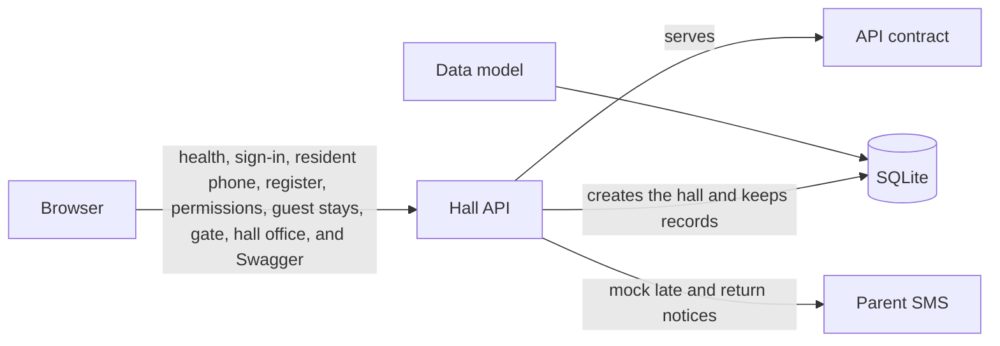

# System architecture

Picture date: **2026-10-01**

This is the system that exists in the repository today. A solid arrow is in use. A dashed arrow is written down and is not on the running path. When a part is added, removed, or connected, this picture is updated in the same change.

| Arrow | Meaning |
|---|---|
| Browser → Hall API | In use. The process is FastAPI on this computer, at `http://127.0.0.1:8000`. `GET /health` answers. `GET /ready` opens an existing hall database and reports `user_version`. A missing or unreadable file answers 503 and is not created. Sign-in answers. The resident phone answers for home, history, hall pass, destinations, ordinary outings, late-night and home-going permissions, and guest stays. A warden or the provost can read the register presence board, the permission queue, and guest stays, and can decide pending permissions and guest stays and mark payment. Gate staff can scan a hall pass, list recent gate activity, and record guest arrival and departure. The provost can manage settings, blocks, rooms, destinations, residents, staff, password reset, the audit log, the SMS log, and register CSV export. Swagger is at `/docs`. |
| Hall API → API contract | In use. `/docs` reads `backend/openapi.yaml`. [`api.md`](api.md) is the same contract for reading. The Auth, Resident, Register, Permissions, Guest Stays, Gate, and Hall office paths in that file are implemented and registered. |
| Data model → SQLite | In use. [`database.md`](database.md) is applied when the service starts. After startup the hall records exist. |
| Hall API → SQLite | In use. The process opens the database and creates the hall when the file is new. Sign-in reads and writes people, sessions, and the audit log. Resident home, history, hall pass, destinations, ordinary outings, permissions, and guest stays read and write their tables. The register presence board reads active residents by block, open outings for lateness, waiting permissions, and guest stays for the dining and should-have-left counts. Gate scans and gate guest routes write outings and guest stays. The hall office reads and writes settings, places, accounts, and audit entries, and reads guardian message rows for the SMS log. The process refuses to start when the signing key is missing or shorter than 32 bytes. |
| Hall API → Parent SMS | In use with the mock driver. Outside production the process stops unless the SMS driver is mock. Reading the register (and a return scan) records late notices for outside outings past grace; a return scan records the return notice when a late notice was sent. No phone network is contacted. |

The phone app, Docker, Nginx, and the VPS are absent from this picture. They are drawn here when that part exists in the project.
