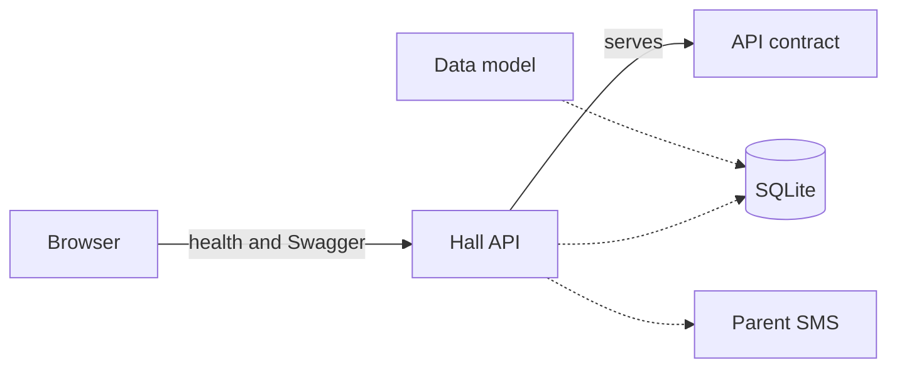

# System architecture

Picture date: **2026-09-29**

This is the system that exists in the repository today. A solid arrow is in use. A dashed arrow is written down and is not on the running path. When a part is added, removed, or connected, this picture is updated in the same change.

| Arrow | Meaning |
|---|---|
| Browser → Hall API | In use. The process is FastAPI on this computer, at `http://127.0.0.1:8000`. `GET /health` answers. Swagger is at `/docs`. |
| Hall API → API contract | In use. `/docs` reads `backend/openapi.yaml`. [`api.md`](api.md) is the same contract for reading. One route is implemented. The others are specified. |
| Data model → SQLite | Written, not created. [`database.md`](database.md) is the model. No tables exist yet. |
| Hall API → SQLite | Not connected. Routes do not open the database. The connection code is in `backend/app/db.py` and is unused. |
| Hall API → Parent SMS | Guard only. Outside production the process stops unless the SMS driver is mock. No message is sent. |

The phone app, Docker, Nginx, and the VPS are absent from this picture. The later hosting plan is [`architecture.md`](architecture.md).
