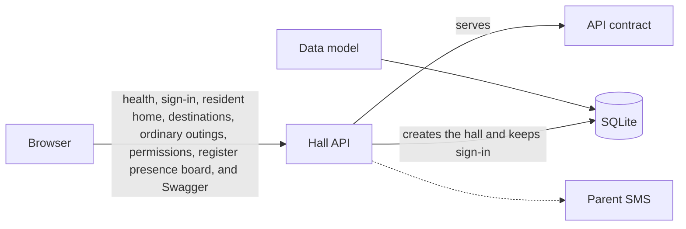

# System architecture

Picture date: **2026-10-01**

This is the system that exists in the repository today. A solid arrow is in use. A dashed arrow is written down and is not on the running path. When a part is added, removed, or connected, this picture is updated in the same change.

| Arrow | Meaning |
|---|---|
| Browser → Hall API | In use. The process is FastAPI on this computer, at `http://127.0.0.1:8000`. `GET /health` answers. Sign-in answers. Resident home answers. The destination list answers. Planning several ordinary outings, including more than one return on the same day, reading those plans, reading the outing she is on, and cancelling one chosen plan answer. A resident can submit, list, read, and cancel late-night and home-going permissions. A warden or the provost can read the permission queue, read one permission, and approve or reject a pending request. A warden or the provost can read the register summary, the resident register with filters, one resident's record, and the late list. Swagger is at `/docs`. |
| Hall API → API contract | In use. `/docs` reads `backend/openapi.yaml`. [`api.md`](api.md) is the same contract for reading. Sign-in, resident home, the destination list, ordinary outings, late-night and home-going permissions, and the register presence board are implemented. The other routes are specified. |
| Data model → SQLite | In use. [`database.md`](database.md) is applied when the service starts. After startup the hall records exist. |
| Hall API → SQLite | In use. The process opens the database and creates the hall when the file is new. Sign-in reads and writes people, sessions, and the audit log. Resident home reads the resident, her open outing, the permission she is waiting on or cleared to use, and her latest exits and returns. The destination list reads the active ordinary-outing choices. Planning writes a planned ordinary outing, and other plans may already exist on that day or a later day. Reading the plans, reading the outing she is on, reading home, or cancelling a plan cancels a planned outing whose expected return has passed, with no staff member. The resident can cancel the plan she chooses, and she stays inside. Submitting a late-night or home-going permission writes a pending row. Listing or reading a permission expires an unused approved permission whose expected return has passed. The resident can cancel while pending or approved. A warden or the provost reads the permission queue and decides only a pending request; approval does not create an outing. The register presence board reads active residents by block, open outings for lateness, waiting permissions, and guest stays for the dining and should-have-left counts. The other business routes do not read or write it yet. The process refuses to start when the signing key is empty. |
| Hall API → Parent SMS | Guard only. Outside production the process stops unless the SMS driver is mock. No message is sent. |

The phone app, Docker, Nginx, and the VPS are absent from this picture. They are drawn here when that part exists in the project.
